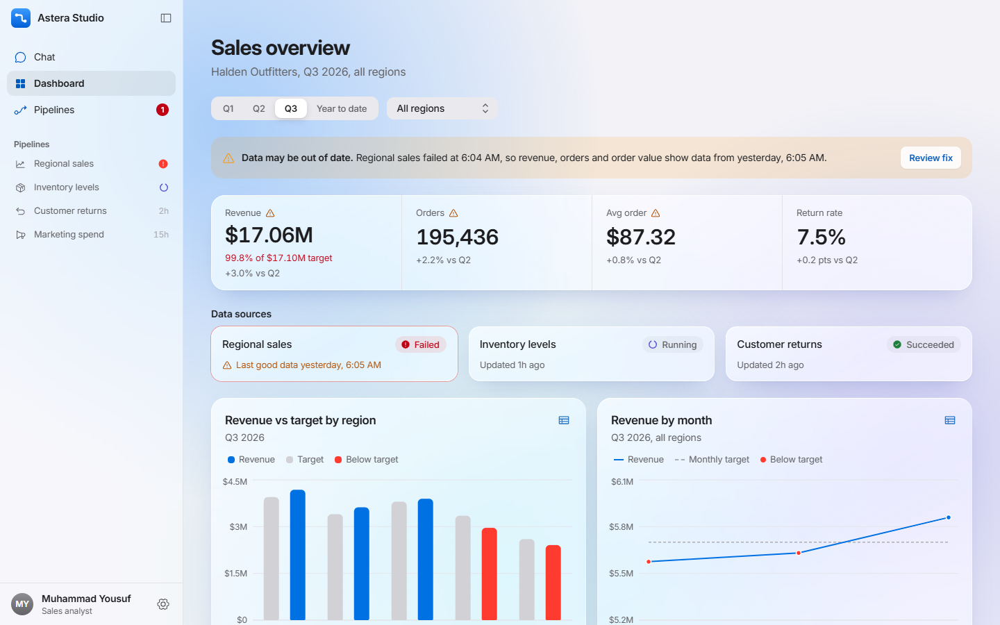
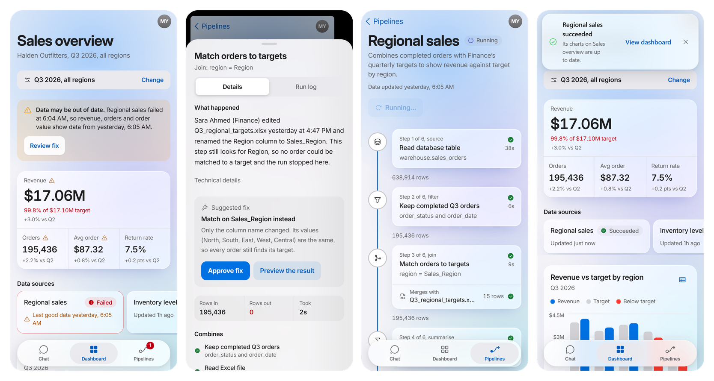
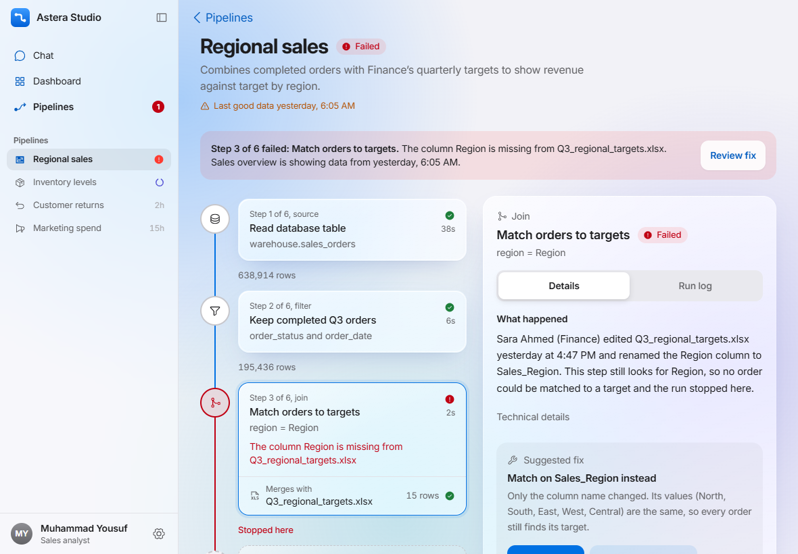
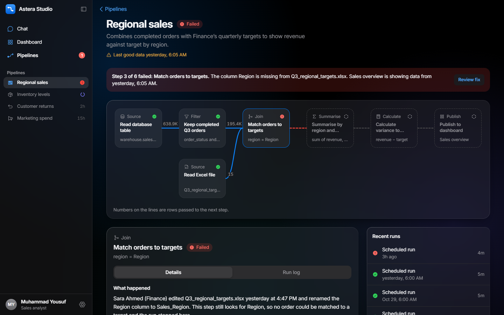

<div align="center">

# Astera Studio

**Chat-first analytics you can trust, on every screen.**<br>
Ask a question, get a chart. When the data behind it breaks, see why in plain words and fix it safely, even from your phone.

[**Open the live demo**](https://iamusuff.github.io/astera-studio/) ·
[All three devices side by side](https://iamusuff.github.io/astera-studio/#/preview) ·
[Design note](NOTE.md)

<br>



</div>

<br>

> A clickable, responsive mockup built for the Astera Software Developer Intern take-home assessment.
> Plain JavaScript, React and Tailwind. No backend: every number is made up, but every number is computed, so the screens always agree with each other.
> Nothing to install: open the live demo, or `Astera Studio.html` from the submission zip (the whole app in one file).

## The idea: designed for trust

A chart is only as good as the pipeline that feeds it. Most dashboards hide that link, so when a pipeline breaks, people keep making decisions on old numbers without knowing.

Astera Studio keeps the link visible everywhere and turns a failure into a two-minute fix:

1. **You notice.** The dashboard says *"Data may be out of date"* on exactly the numbers that are affected, and names the pipeline.
2. **You understand.** The failed step explains what happened in plain language: *Sara from Finance renamed the `Region` column to `Sales_Region`, so no order matched a target.*
3. **You approve.** Studio suggests a fix and lets you preview the result. Nothing changes until a person approves it, and approving can be undone. This is the same *AI proposes, a human approves* model Astera uses for governed AI.
4. **It's fixed.** Re-run from that step and watch it go through. The warning disappears from the dashboard, the chat and the sidebar at once.



## What's in it

| The brief asks for | Where it is |
| --- | --- |
| **Chat**: question → chart + summary, pin to dashboard | `Chat`: 5 answers with charts and summaries, follow-up chips that change the chart, *View as table*, *Pin to dashboard* with Undo |
| **Dashboard**: KPIs, charts, data freshness, pipeline status | `Dashboard`: 4 KPIs, 4 charts, a *Data sources* strip with each pipeline's status, freshness on every chart |
| All four statuses | Regional sales **Failed**, Inventory levels **Running**, Customer returns **Succeeded**, Marketing spend **Scheduled** |
| **Pipeline detail**: steps and how they connect | `Pipelines → Regional sales`: a flow diagram on desktop, and a vertical step spine on iPad and iPhone |
| Re-run failed steps | *Approve fix → Re-run from this step*, with a simulated run that updates every screen |
| Filters | Date range and region on the dashboard, and an editable filter step in the pipeline that previews its row count before you save |
| Ask chat to change a chart | Follow-ups like *"Show that as a percentage of target"* and *"How does that compare to Q2?"* |
| View the pipeline behind a chart | Every chart's footer links to its pipeline; a stale chart links straight to the failed step |
| Drill down | Tap a region's bar (or its name) to open that region by store and product category |

## One app, three devices

The layout **adapts** rather than shrinking. Each device gets the pattern that's natural on it.

| | iPhone | iPad | Desktop |
| --- | --- | --- | --- |
| Navigation | Floating tab bar | Tab bar (portrait), sidebar (landscape) | Collapsible sidebar listing every pipeline |
| Pipeline | Vertical step spine. A merge is a *Merges with* chip, not crossing lines | Spine + step inspector, side by side | Full flow diagram with measured connectors + inspector |
| Step details | Bottom sheet you can drag to dismiss | Side panel | Panel below the diagram |
| Dashboard filters | One *Change* button → sheet | Inline | Inline |
| Chat | Composer above the tab bar | Wider single column | Conversation + a rail with pins and data health |

<table>
  <tr>
    <td width="50%"></td>
    <td width="50%"></td>
  </tr>
  <tr>
    <td align="center"><sub>iPad: spine and inspector</sub></td>
    <td align="center"><sub>Desktop, dark: the full flow</sub></td>
  </tr>
</table>

Everything works by touch, with **no hover-only interactions**. Tap targets are 44 pt on touch screens, and inputs are 16 px so iOS doesn't zoom. Content stays clear of the notch and home indicator.

## Two-minute tour

1. **Dashboard:** see the orange *Data may be out of date* banner, then tap **Review fix**.
2. **Read the explanation**, tap **Preview the result**, then **Approve fix**. Changed your mind? Use **Undo** in the banner.
3. Tap **Re-run from this step** and watch the steps go green one by one.
4. Go back to the **Dashboard**: the warning is gone and *Regional sales* says *Updated just now*.
5. **Chat:** ask *"Which regions missed their sales target last quarter?"*, pin the answer, then try a follow-up.
6. **Settings** (the gear next to the name, or the avatar on a phone): switch **Light / Dark** and watch the light spread from the button, or **Reset demo data** to start over.

On a keyboard: <kbd>/</kbd> to ask a question from anywhere, <kbd>[</kbd> to hide the sidebar.

## Design decisions

- **Color means status.** The interface is quiet and neutral. Red always means something needs attention, so it's never decoration.
- **The pipeline is a spine on small screens, not a tiny canvas.** I dropped the idea of one pan-and-zoom canvas for every device: on a phone you'd spend the whole time pinching. Most pipelines are a chain with a few side inputs, so a vertical list with *Merges with* chips shows the same structure and stays readable with a thumb.
- **Explain, suggest, let a person approve.** Errors are written for the person who owns the dashboard, not the engineer. The technical message is one tap away.
- **Changes preview before they apply, and can be undone.** Editing the filter shows *195,436 → 209,651 rows* before you save. Undo restores only what that action changed, so it never undoes a run that finished in the meantime.
- **Feel native.** Apple's system colors, large titles that collapse into a glass bar, sheets that shrink the page behind them, spring motion and translucent materials, all in light and dark. Under *Reduce motion* and *Reduce transparency* the app becomes still and solid.
- **Honest data.** One fictional retailer, *Halden Outfitters*. KPIs, charts, chat answers and pipeline row counts are all computed from the same orders, and `tools/check-data.mjs` checks they agree (17 checks). The demo clock is fixed, so "3h ago" is always true.

## Built with

| | |
| --- | --- |
| **React 18 + Vite** | Plain JavaScript: small enough to explain line by line |
| **Tailwind CSS v4** | Design tokens in one `@theme` block; responsive variants make each layout explicit |
| **Recharts** | Charts with tap-friendly tooltips and a data-table alternative |
| **Motion** | Spring transitions, shared-layout animations (tab highlight, sidebar selection, segmented controls) |
| **Vaul / Sonner** | Native-feeling bottom sheets and banners with Undo |
| **Phosphor icons, Inter** | One consistent icon set; Inter with optical sizing, bundled so it works offline |
| **React Router (hash)** | Works on GitHub Pages and when opening the single HTML file from disk |

State is one React context with `useReducer` (pins, filters, chat, pipelines, undo): an action on one screen shows up on all of them. Runs are simulated by a timer that moves each step through *waiting → running → succeeded/failed*, honoring the real step graph.

## Quality

Verified during development with Playwright on iPhone (375), iPad portrait (768), iPad landscape (1024) and desktop (1440):

- **Flows:** the chat, dashboard and pipeline flows plus end-to-end logic scenarios (fix and re-run, re-run without a fix, edit then run, undo after another run finished, reset mid-run) run with no console errors.
- **Accessibility:** [axe-core](https://github.com/dequelabs/axe-core) reports **0 violations** in light and dark mode, including with menus and sheets open. Status is never shown by color alone, focus rings are visible, and everything works by keyboard.
- **Data:** `node tools/check-data.mjs` passes 17 consistency checks.

## Run it locally

```bash
npm install
npm run dev            # http://localhost:5173
npm run build          # dist/: what GitHub Pages serves
npm run build:single   # dist-single/index.html: the whole app in one file, opens by double-click
node tools/check-data.mjs
```

Needs Node 20.19+ (Vite 8). Every push to `main` is built and deployed to GitHub Pages by `.github/workflows/deploy.yml`.

## Project structure

```
src/
  data/         the sample business: orders, metrics, pipelines, chat answers
  state/        AppStore (one reducer for everything), pipeline run logic, theme
  features/     chat/ · dashboard/ · pipelines/ · preview/   (one folder per screen)
  components/   layout/ (shell, sidebar, tab bar, headers, settings) · ui/ · charts/
  lib/          formatting, the demo clock, view transitions
tools/          data consistency checks, screenshot scripts
docs/media/     images for this README
```

## What I'd build next

- **Real pipelines:** read status, row counts and run history from Astera's API instead of the sample business, so the same screens monitor production data.
- **A language model behind chat,** kept inside the same rules: every answer cites the pipeline it came from, and anything that changes data still waits for a person to approve it.
- **Alerts with a destination:** when a pipeline feeding your dashboard fails, a notification opens the exact failed step, the way *Review fix* does today.
- **Lineage for every number:** tap a KPI to see each step it passed through, with row counts, from source to chart.

---

<sub>Made by **Muhammad Yousuf** (FAST-NUCES, batch 2023). Astera Studio is the product concept from the assessment brief; Halden Outfitters and everyone in the data are fictional.</sub>
